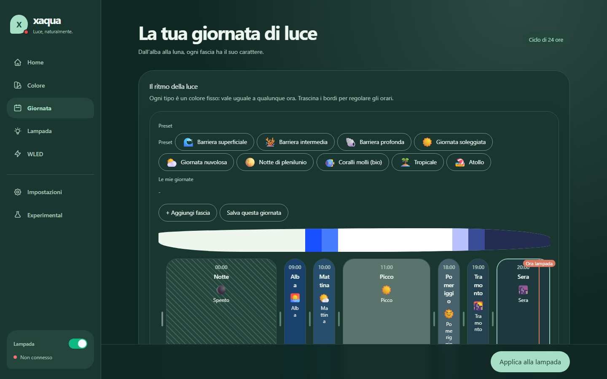
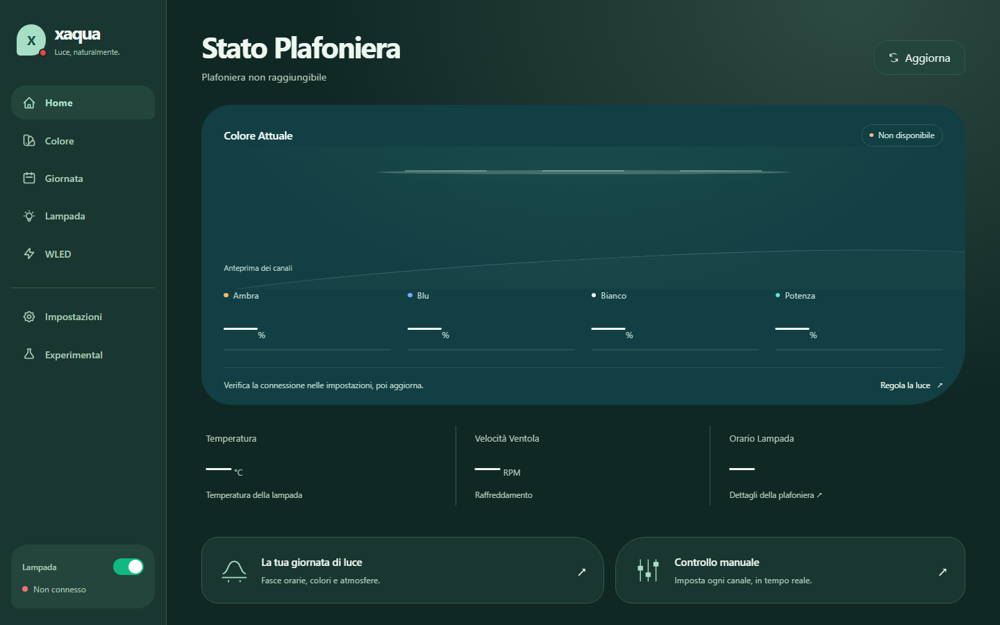

# Xaqua Web Controller

A self-hosted web app to control **Xaqua** aquarium LED fixtures (Xaqua Smart Connector) from any
browser on your network, plus optional **WLED** lights. Node.js / Express, server-rendered UI,
no database, runs in Docker.



## Features

- **Day of light**: compose the whole day as time slots (sunrise, morning, peak, afternoon, sunset,
  evening, night), each with its own light type. Drag the edges to move the times, pick a preset
  (shallow / intermediate / deep reef, sunny, cloudy, full moon, tropical, atoll, ...) or save your own.
- **Live color**: set Amber, Blue, White and Power (0-100) in real time.
- **Lamp status**: temperature, fan speed, lamp clock, power toggle, online indicator.
- **WLED**: discover WLED devices on the LAN and run white/blue schedules on them.
- **Experimental**: gradual coral acclimation (light ramps up over a number of weeks).
- **Diagnostics**: in-app log viewer.
- Italian UI, mobile navigation bar.



## Quick start

```bash
npm ci
cp .env.example .env     # set DEVICE_IP of your Xaqua lamp
npm start                # http://localhost:3000
```

With Docker:

```bash
docker compose up -d --build
```

The compose file uses `network_mode: host` so WLED discovery can scan the LAN. Settings and the
current schedule are stored in `data/config.json` (created on first save, not committed).

## Configuration

- `.env` (or environment variables): `DEVICE_IP`, `DEVICE_USERNAME`, `DEVICE_PASSWORD`
  (factory default `Admin` / `Admin`), `PORT`.
- In the UI, **Impostazioni** (settings): lamp IP, aquarium depth, and optionally an
  [OpenWeatherMap](https://openweathermap.org/api) API key + city (`City,CC`, e.g. `Rome,IT`).
  The key is never sent back to the browser.

There is no built-in login. Keep it on your LAN, or put it behind an authenticating reverse proxy
or tunnel (e.g. Cloudflare Access) if you need remote access.

## The Xaqua firmware (read before changing the device client)

The lamp runs proprietary firmware on a TI CC3200 module with a small JSON-over-HTTP API. It is
fragile, and the client in `src/services/xaquaClient.js` works around it on purpose:

- Responses are not valid HTTP (`LF` only): requests use `insecureHTTPParser: true` and
  `Connection: close`. Bursts of requests cause `socket hang up`, so calls are spaced out.
- A schedule is applied in **two phases, in this order**: `SetColorSchedule` with only
  `{ Steps, Period }`, then one `SetColorScheduleTransition(i, step)` per step (`i = 0..N-1`),
  ~500 ms after phase 1 and ~1 s between steps.
- `SetColorSchema` sets the instant color. Avoid `SetColorTransition` with long `DeltaSeconds`
  (firmware bug). `GetColorSchedule` is unreliable: the app keeps the schedule state itself.
- Step times use a fixed fake date (`2015/12/01 - HH:MM:SS`); only the time of day matters.

Endpoints (POST, JSON, token `"1234"` returned by `Login/`):

```
Login/                         { Username, Password }        -> { LoginResult: "1234" }
GetLampStatus/                 { token }                     temperature in 1/100 °C
GetTime/ · SetTime/            { token[, time] }             "yyyy/MM/dd - HH:mm:ss"
GetColorSchema/ · SetColorSchema/   { token[, cs:{Amber,Blue,White,Power}] }
SetColorSchedule/              { token, cs:{ ID:1, Name:"Manual", Description:"", Image:"", Steps, Period } }
SetColorScheduleTransition/    { token, step, ct:{ From, To, DeltaSeconds, Time } }
GetLampInfo/ · SetLampInfo/    { token[, lamp] }
```

## Main API

- `GET /api/status`, `GET /api/ping`, `GET|POST /api/color`, `POST /api/power`, `GET /api/lampinfo`
- `GET /api/schedule/reels`, `POST /api/schedule/compose` (compose + apply), `GET|POST|DELETE /api/schedule/daypresets`
- `GET|POST /api/settings`, `GET /api/weather/test`
- `/api/wled/*`: devices, discovery, state, schedules
- `GET /api/logs`, `POST /api/logs/clear`

## Tests

```bash
npm test -- --runInBand
```

## License

MIT, see [LICENSE](LICENSE). Not affiliated with Xaqua. Use at your own risk.
